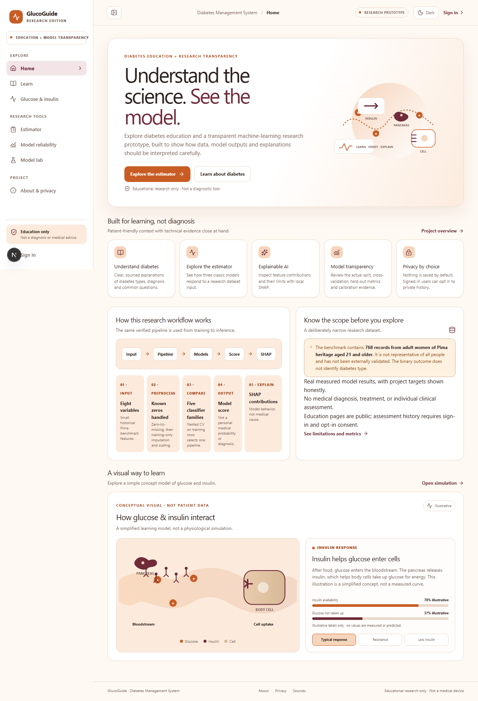
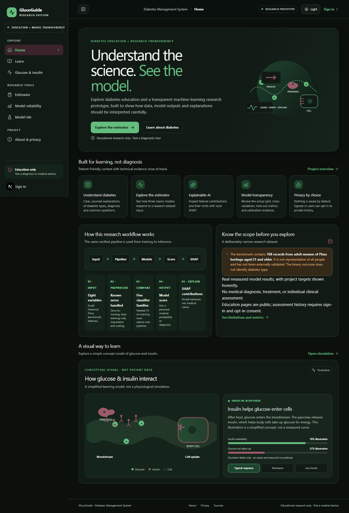

# Diabetes Management System · GlucoGuide

**A diabetes education and explainable ML research website.** GlucoGuide pairs a patient-friendly learning experience with a transparent, reproducible Pima benchmark workflow. It is not a medical device, diagnosis, screening service, treatment tool or clinically validated risk calculator.

> **Please do not use this model for health decisions.** It estimates patterns learned from a small historical binary-label dataset. It cannot identify Type 1, Type 2 or gestational diabetes, and its score is not a personal medical probability. For health concerns, contact a qualified healthcare professional.

## Product pages

- **Home:** education-first overview, scope limits and the verified research workflow.
- **Learn:** diabetes basics and types, common symptoms, clinical testing, nuanced Type 2 risk-reduction education, myths/FAQ and dated official source notes.
- **Glucose & insulin:** original interactive SVG concept illustration; its example levels are explicitly illustrative.
- **Estimator:** authenticated users can enter values or upload a PDF/PNG/JPEG laboratory report for local extraction and review; visitors can only run the labeled synthetic demo. Laboratory observations remain separate from model inputs, and only explicitly confirmed, semantically matching values can be copied into the Pima form. Results show the model score/class threshold, release version, candidate model scores, local SHAP and safe next-step information. Reports download as standalone HTML.
- **Model reliability:** generated held-out metrics/figures, definitions, cross-validation selection and one-feature sensitivity curves.
- **Model lab:** model assumptions, preprocessing, model selection, dataset scope, actual metrics and SHAP limits.
- **About & privacy:** architecture, dataset fingerprint, methodology, limitations, privacy and account history controls.
- **Dashboard, My history, Account settings:** protected routes for opted-in user records, export and delete controls.

Light and dark brand palettes use browser-persisted preference and follow system preference at first visit. The sidebar collapses on desktop and becomes a navigation drawer on mobile.

### Screenshots

Captured from the implemented Next.js home page in both persistent theme settings.





## Architecture

```mermaid
flowchart LR
  CSV[Verified Pima CSV] --> TRAIN[Offline Python training]
  TRAIN --> ART[Five pipelines + SHA-256 manifest]
  ART --> API[FastAPI · inference and evidence]
  WEB[Next.js App Router] -->|same-origin API proxy| API
  WEB --> AUTH[Supabase SSR Auth]
  WEB -->|verified user JWT| API
  API -->|JWT + publishable key| PG[Supabase PostgreSQL]
  PG --> RLS[RLS ownership via auth.uid()]
```

The established Python research modules, dataset, model artifacts and generated reports remain in place. The old Streamlit UI was removed so the repository has one frontend. Full details: [architecture](docs/architecture.md), [ML methodology](docs/ml-methodology.md), [dataset provenance](docs/dataset-provenance.md), [deployment](docs/deployment.md), [security and privacy](docs/security-and-privacy.md), [known limitations](docs/known-limitations.md), [model card](docs/MODEL_CARD.md) and [data card](docs/DATA_CARD.md).

## Requirements and local setup

Use Python 3.11 to match the saved model pipeline runtime and Node.js 20.9 or newer. Windows PowerShell, from the repository root:

```powershell
py -3.11 -m venv .venv
.\.venv\Scripts\Activate.ps1
python -m pip install -r requirements-dev.txt
python -m src.data_validation data/diabetes.csv
```

Copy the example environment file for the backend, then edit values if Supabase is configured:

```powershell
Copy-Item .env.example .env
python -m uvicorn backend.main:app --reload --env-file .env --port 8000
```

Scanned reports and images require the local Tesseract OCR executable. The Docker API image installs it. On Windows, install Tesseract separately and ensure `tesseract.exe` is on `PATH`; text-based PDFs do not need OCR. Uploaded reports are limited to 10 MB and 5 PDF pages, use a temporary upload buffer that is cleaned up after processing, and are not persistently retained. Upload requires sign-in.

In a second PowerShell window, configure the Next.js runtime and start the website:

```powershell
Copy-Item .env.example frontend/.env.local
Set-Location frontend
npm ci
npm run dev
```

Open `http://localhost:3000`. The FastAPI OpenAPI page is `http://localhost:8000/docs`; liveness/readiness are `/health/live` and `/health/ready`. Public learning pages and the synthetic demonstration work without Supabase credentials. Account registration, email verification, reset, dashboard and private history require a configured project.

To rebuild model artifacts and reports after changing the training code/data:

```powershell
python scripts/train.py
```

### Tests, lint and build

From the repository root:

```powershell
python -m pytest -q -o addopts=''
python -m compileall -q src scripts backend tests
Set-Location frontend
npm run lint
npm run typecheck
npm run build
npx playwright install chromium
npm run test:e2e
```

`frontend/.env.local` should be created from `.env.example` before starting Next.js. Do not commit `.env`, `.env.local` or any real credentials.

## Dataset and method

The checked-in CSV is the common 768-row Pima Indians Diabetes benchmark redistribution, with eight predictors and binary `Outcome`. Its population is commonly described as adult women of Pima heritage aged 21 and older. It is not representative of all users or the wider Indian population.

- Raw SHA-256: `698c203a14aa31941d2251175330c9199f3ccdb31597abbba2a3e35416257a72`
- Canonical values SHA-256: `00921e2c6a3f645b215270e6b481a1b3e6283f1db4ee498d0de9b5a9cd0b240b`
- Known zero codes in Glucose, BloodPressure, SkinThickness, Insulin and BMI are changed to missing inside the saved pipeline; median imputation and scaling are fitted only on training rows. `Pregnancies = 0` remains valid.
- A stratified 80:20 split (seed 42) is used. The research workflow uses nested five-fold outer/four-fold inner CV to compare the approved Logistic Regression, Gaussian Naive Bayes and Random Forest models plus RBF SVM and Gradient Boosting. Preprocessing and hyperparameter search stay inside folds; class weighting is searched for LR/RF/SVM. Selection uses nested OOF ROC-AUC with a predeclared simplicity tie-break. This current run evaluates the selected model after choices are fixed. However, prior repository experiments explicitly explored thresholds on the same nominal holdout, so the saved test results are descriptive and not independent confirmatory evidence.
- SHAP explains model behavior for the exact selected estimator/pipeline and input; it does not establish medical causation. The score is not a personal clinical probability.

## Measured release results

The dashboard's original numbers were independently checked against the saved baseline reports. The same stratified seed-42 80:20 split is used for comparison. The operating threshold was chosen on nested OOF training predictions, with recall ≥0.65 and precision ≥0.50, then evaluated in the release training run on the 154-row nominal holdout. Prior exploratory analyses used that same split, so it is not untouched or independent.

| Evaluation | Threshold | Accuracy | Balanced accuracy | Precision | Recall | Specificity | F1 | ROC-AUC | PR-AUC | Brier | FN |
|---|---:|---:|---:|---:|---:|---:|---:|---:|---:|---:|---:|
| Saved baseline Logistic Regression | 0.500 | 0.708 | 0.660 | 0.600 | 0.500 | 0.820 | 0.545 | 0.813 | 0.673 | 0.175 | 27 |
| New selected Logistic Regression | 0.492 | 0.714 | 0.712 | 0.576 | 0.704 | 0.720 | 0.633 | 0.810 | 0.665 | 0.181 | 16 |

Recall is 20.4 percentage points higher than the API's actual baseline threshold, with precision lower by 2.4 points, specificity lower by 10 points, and 11 fewer false negatives on the same comparison split. ROC-AUC and PR-AUC changed slightly downward, and Brier score worsened; this is a threshold trade-off, not a uniform improvement in ranking or calibration. The 95% stratified bootstrap recall interval is 0.574–0.815; it conditions on this small, historically exposed split and excludes model-selection/training uncertainty. No independent confirmatory improvement is established. The selected nested OOF comparison metrics and generated results are in reports/.

The former report separately displayed an LR 0.40 threshold test row (recall 0.648, precision 0.614), but that threshold was not saved for API inference. The new model card and serving threshold are synchronized. No external validation, clinical calibration, prospective evaluation or subgroup fairness review was performed.

The original three-model artifacts are archived under models/baseline_v1, with their generated evidence under reports/baseline_v1 and docs/MODEL_CARD_baseline_v1.md. Reproduce that historic baseline with python scripts/train_baseline.py --quick. The canonical release command is python scripts/train.py.

## Environment variables

`NEXT_PUBLIC_SUPABASE_URL`, `NEXT_PUBLIC_SUPABASE_PUBLISHABLE_KEY` (frontend publishable values); `SUPABASE_URL`, `SUPABASE_ANON_KEY`, `CORS_ORIGINS`, `API_BASE_URL` (server-side). Obtain project values from Supabase project API settings and set host values in Vercel/Render secret/environment settings. The anon/publishable key is intentionally used with the user's own token; do not add a service-role key.

## Supabase and privacy

1. Create a Supabase project and enable email/password Auth.
2. Add local and deployed frontend callback URLs (`/auth/callback`) to Auth redirect allowlists.
3. Run [`backend/schema.sql`](backend/schema.sql) in the Supabase SQL editor.
4. Set the public frontend URL/key and server-only API URL/key/CORS origins.
5. Test verification, reset, logout, consent, export, delete and cross-account denial with two accounts before deployment.

Assessment history is disabled unless a signed-in user explicitly opts in after a prediction. The API verifies the Auth session; PostgreSQL RLS uses `auth.uid() = user_id` for every read/write/delete. Self-service account deletion and a custom retention period are not configured. This project has no regulatory or security compliance certification; do not submit identifiable or real patient records.

## Deployment

- **Frontend:** deploy `frontend/` as a Next.js App Router project on Vercel. Set the Supabase public values and server-only `API_BASE_URL`.
- **API:** deploy using [`render.yaml`](render.yaml) and [`backend/Dockerfile`](backend/Dockerfile). Set `SUPABASE_URL`, `SUPABASE_ANON_KEY`, and the exact deployed frontend origin in `CORS_ORIGINS`. Health probe: `/health/ready`.
- **Database/Auth:** use Supabase; run `backend/schema.sql` and configure Auth redirects. Never expose a service-role key.
- Local container setup: `Copy-Item .env.example .env; docker compose up --build` after editing environment values.

The project is **not deployed** and has no live URL. No Supabase credentials or deployment account were available for this work. GitHub Actions workflow is configured to run data checks, Python tests, frontend lint/typecheck/build and Playwright flows; a hosted Actions run has not been observed.

## Contribution and limitations

The defensible contribution is an understandable integration of dataset identity checks, leakage-safe training, three-model comparison, explainability, reliability evidence and sourced education in one user-facing application. It is not a new classifier or validated healthcare product. Read [known limitations](docs/known-limitations.md) before reuse.
