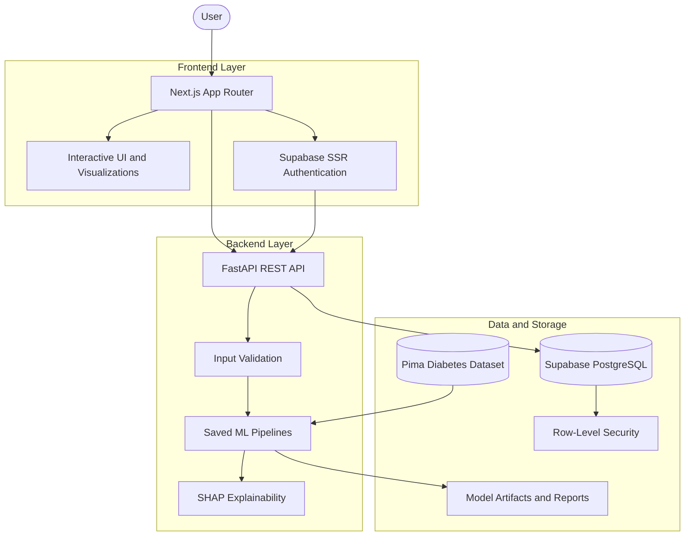

 <div align="center">

# GlucoGuide

### Explainable AI · Diabetes Education · Machine Learning Research

**An interactive, education-first healthcare AI platform built around transparent machine learning, reproducible experiments, and responsible health information.**

[](https://www.python.org/)
[](https://fastapi.tiangolo.com/)
[](https://nextjs.org/)
[](https://www.typescriptlang.org/)
[](https://scikit-learn.org/)
[](https://supabase.com/)
[](LICENSE)

</div>

---

## Overview

GlucoGuide is a full-stack diabetes education and explainable machine learning research platform designed to make diabetes-related information and ML-based analysis more understandable and transparent.

The project combines an interactive educational website with a reproducible machine learning workflow, model evaluation, SHAP-based interpretability, and laboratory report extraction.

Rather than presenting machine learning predictions as medical facts, GlucoGuide emphasizes model transparency, dataset limitations, evaluation evidence, and responsible interpretation.

**The central objective is to demonstrate how machine learning, explainable AI, data analysis, and full-stack engineering can be integrated into a research-oriented healthcare education application.**

> **Medical Disclaimer:** GlucoGuide is an educational and research project, not a medical device. Its machine learning model is not clinically validated and must not be used for diagnosis, screening, treatment, or personal healthcare decisions.

---

## Core Features

| Module | Description |
|---|---|
| **Public Screening (System A)** | No login required. Enter physical measurements — age, sex, BMI, waist, blood pressure, activity and smoking — to receive a non-laboratory screening estimate from Model 2 (NHANES). |
| **Research Dashboard (System B)** | Side-by-side comparison of both models: algorithms, datasets, evaluation metrics, confusion matrices, ROC curves, calibration, SHAP explanations, feature importance. |
| **Personal Progress (System C)** | Registered users can save assessments, view their history, compare measurements over time, and export CSV reports. |
| **Diabetes Education** | Interactive learning resources covering diabetes types, symptoms, clinical testing, prevention education, and frequently asked questions. |
| **Glucose & Insulin** | Original interactive SVG illustration explaining glucose and insulin concepts. |
| **ML Estimator (Pima)** | Model-based estimation using the selected Pima benchmark features, with threshold-aware classification. |
| **Laboratory Report Analysis** | Local extraction and review of laboratory values from PDF and image reports, with user confirmation before transferring matching values into the model form. |
| **Explainable AI** | SHAP-based explanations illustrating how input features influence model outputs. |
| **Model Reliability** | Evaluation metrics, cross-validation evidence, calibration analysis, and sensitivity experiments. |
| **Model Laboratory** | Exploration of preprocessing, model assumptions, selection methodology, evaluation results, and limitations. |
| **Interactive Visualizations** | Model performance charts, feature importance, confusion matrices, ROC curves, and experimental results. |
| **Authentication & Privacy** | Supabase authentication, protected account routes, optional assessment history, and user data controls. |

---

## System Architecture

GlucoGuide follows a modular full-stack architecture separating the user interface, machine learning inference, authentication, and persistent data storage.



### Technology Stack

| Layer | Technologies |
|---|---|
| Programming | Python, TypeScript |
| Frontend | Next.js, React, CSS |
| Backend | FastAPI, Uvicorn |
| Machine Learning | Scikit-learn, NumPy, Pandas |
| Explainability | SHAP |
| Data Visualization | Matplotlib, Interactive Charts, SVG |
| Authentication | Supabase Auth |
| Database | PostgreSQL, Supabase |
| Testing | Pytest, Playwright |
| Deployment Configuration | Docker, Docker Compose, Render, Vercel |

---

## Machine Learning Methodology

This project uses **two completely independent ML models**. They share no data, feature schemas, artifacts or APIs.

---

### Model 1 — Pima Research Model (existing, preserved)

The ML pipeline is built around the Pima Indians Diabetes benchmark dataset.

### Dataset Overview

| Property | Details |
|---|---|
| Dataset | Pima Indians Diabetes |
| Observations | 768 |
| Input Features | 8 |
| Target Variable | Outcome |
| Problem Type | Binary Classification |
| Dataset Type | Historical benchmark dataset |

The dataset contains eight numerical predictors and a binary target variable.

### Input Features

1. Pregnancies
2. Glucose
3. Blood Pressure
4. Skin Thickness
5. Insulin
6. BMI
7. Diabetes Pedigree Function
8. Age

### Data Preprocessing

The preprocessing pipeline includes:

- Dataset validation and fingerprint verification.
- Treatment of known invalid zero codes as missing values in selected medical measurements.
- Median imputation.
- Feature scaling.
- Stratified train-test splitting.
- Leakage-aware preprocessing within cross-validation folds.

`Pregnancies = 0` is retained as a valid value.

### Models Evaluated

The research workflow compares:

| Algorithm | Purpose |
|---|---|
| Logistic Regression | Interpretable linear classification baseline |
| Gaussian Naive Bayes | Probabilistic classification |
| Random Forest | Ensemble-based classification |
| Support Vector Machine (RBF) | Nonlinear classification |
| Gradient Boosting | Sequential ensemble learning |

Model selection uses nested cross-validation, with preprocessing and hyperparameter search performed inside the appropriate folds.

The selected release estimator is Logistic Regression.

---

### Model 2 — Public Screening Model (new, NHANES)

A completely independent ML pipeline for non-laboratory diabetes screening estimates.

**Dataset:** NHANES 2017–2018 (Cycle J) — public domain CDC survey data, no registration required.

| Property | Details |
|---|---|
| Dataset | NHANES 2017–2018 (US national health survey) |
| Eligible participants | 4,900 adults aged 21+ |
| Positive (survey-defined diabetes) | 1,066 (21.8%) |
| Input features | 11 non-laboratory measurements |
| Target | DIQ010==1 (diagnosed) OR HbA1c ≥ 6.5% |
| Selected model | Logistic Regression |
| Test ROC-AUC | 0.796 (95% CI: 0.766–0.828) |
| Test recall | 0.714 |
| Test F1 | 0.533 |
| Threshold | 0.26 (validation-selected, recall ≥ 0.60) |

**Features (all non-laboratory):**
Age, sex, BMI, waist circumference, systolic blood pressure, diastolic blood pressure, moderate activity days/week, vigorous activity days/week, sedentary minutes/day, ever smoked ≥100 cigarettes, currently smoking.

**Leakage prevention:** HbA1c (`LBXGH`) and diabetes diagnosis (`DIQ010`) are used **only** to construct the target label — never as model inputs. This is verified in `tests/test_public_screening.py`.

**Artifacts:** `models/public_screening/` — separate from Pima artifacts in `models/`.

**Documentation:** [`docs/public_model_dataset_audit.md`](docs/public_model_dataset_audit.md)

---

## Application Routes

| Route | Access | Description |
|---|---|---|
| `/` | Public | Home page |
| `/screening` | Public (no login) | Public non-laboratory screening (Model 2) |
| `/screening/result` | Public | Screening result display, save to history |
| `/research` | Public | Research dashboard — both models side by side |
| `/datasets` | Public | Dataset documentation for both models |
| `/estimate` | Public | Pima ML estimator (Model 1) |
| `/reliability` | Public | Pima model reliability metrics |
| `/model-lab` | Public | Pima model lab |
| `/learn` | Public | Diabetes education |
| `/simulation` | Public | Glucose & insulin simulation |
| `/about` | Public | About & privacy |
| `/dashboard` | Authenticated | Personal dashboard |
| `/dashboard/progress` | Authenticated | Screening history and measurement progress |
| `/history` | Authenticated | Pima assessment history |

## Backend API Endpoints

| Endpoint | Method | Auth | Description |
|---|---|---|---|
| `/api/v1/public-screening/metadata` | GET | None | Model card, features, limits |
| `/api/v1/public-screening/evaluation` | GET | None | Evaluation metrics for research dashboard |
| `/api/v1/public-screening/figures/{name}` | GET | None | Evaluation PNG figures |
| `/api/v1/public-screening/predictions` | POST | None | Run public screening prediction |
| `/api/v1/public-screening/history` | GET | Bearer | Retrieve saved screening history |
| `/api/v1/public-screening/history` | POST | Bearer | Save a screening assessment |
| `/api/v1/public-screening/history/export` | GET | Bearer | Export history as CSV |
| `/api/v1/public-screening/history/{id}` | DELETE | Bearer | Delete one assessment |
| `/api/v1/public-screening/history` | DELETE | Bearer | Delete all assessments |

## Database Migration

After setting up Supabase, run **both** SQL files in this order in the Supabase SQL Editor:

1. `backend/schema.sql` — base tables (assessments, etc.)
2. `backend/schema_public_screening.sql` — adds `screening_assessments` table with RLS

---

## Model Evaluation & Results

Model evaluation considers multiple dimensions rather than relying exclusively on accuracy.

### Evaluation Metrics

- Accuracy
- Balanced Accuracy
- Precision
- Recall
- Specificity
- F1-score
- ROC-AUC
- PR-AUC
- Brier Score
- False Negatives

### Measured Release Comparison

The following results compare the saved baseline Logistic Regression model with the newer selected Logistic Regression model.

| Metric | Baseline | Selected Model |
|---|---:|---:|
| Threshold | 0.500 | 0.492 |
| Accuracy | 0.708 | 0.714 |
| Balanced Accuracy | 0.660 | 0.712 |
| Precision | 0.600 | 0.576 |
| Recall | 0.500 | 0.704 |
| Specificity | 0.820 | 0.720 |
| F1-score | 0.545 | 0.633 |
| ROC-AUC | 0.813 | 0.810 |
| PR-AUC | 0.673 | 0.665 |
| Brier Score | 0.175 | 0.181 |
| False Negatives | 27 | 16 |

**Interpretation**

The selected model achieves higher recall than the baseline at its chosen operating threshold, while precision and specificity decrease slightly.

This demonstrates the trade-offs involved in classification threshold selection.

The comparison uses the same 154-observation nominal holdout split. Earlier exploratory experiments also used this split, so it is not an untouched independent test set. These results do not establish clinical validity or independent confirmatory improvement.

### Explainable AI

SHAP is used to investigate how model features contribute to individual predictions and overall model behavior.

The project includes:

- Global feature importance.
- SHAP summary and beeswarm plots.
- Individual prediction explanations.
- Feature sensitivity experiments.

SHAP values explain model behavior; they do not establish medical causation.

---

## Repository Structure

```text
diabetes-management-system/
│
├── .github/
│   └── workflows/              # GitHub Actions CI
│
├── backend/                    # FastAPI backend
│   ├── main.py
│   ├── schema.sql
│   └── Dockerfile
│
├── frontend/                   # Next.js application
│   ├── src/
│   │   ├── app/                # Application routes
│   │   ├── components/         # Reusable UI components
│   │   └── lib/                # API and Supabase utilities
│   ├── package.json
│   └── Dockerfile
│
├── data/                       # Dataset and data documentation
│
├── docs/                       # Technical documentation
│   ├── architecture.md
│   ├── ml-methodology.md
│   ├── DATA_CARD.md
│   ├── MODEL_CARD.md
│   └── known-limitations.md
│
├── models/                     # Trained ML artifacts
│
├── reports/                    # Evaluation and research results
│   ├── baseline_v1/
│   ├── experiments/
│   └── figures/
│
├── scripts/                    # Training and research scripts
│
├── src/                        # ML pipeline modules
│
├── tests/                      # Automated Python tests
│
├── docker-compose.yml
├── requirements.txt
├── requirements-dev.txt
├── render.yaml
└── README.md
```

---

## Installation & Setup

### Prerequisites

- Python 3.11
- Node.js 20.9 or newer
- npm
- Git

### 1. Clone the Repository

```bash
git clone https://github.com/nitishhkr11/diabetes-management-system.git

cd diabetes-management-system
```

### 2. Configure the Python Environment

```powershell
py -3.11 -m venv .venv

.\.venv\Scripts\Activate.ps1

python -m pip install -r requirements-dev.txt
```

### 3. Validate the Dataset

```bash
python -m src.data_validation data/diabetes.csv
```

### 4. Configure the Backend

From the project root:

```powershell
Copy-Item .env.example .env
```

Configure the required environment variables if using Supabase.

Start the FastAPI backend:

```bash
python -m uvicorn backend.main:app --reload --env-file .env --port 8000
```

Backend documentation:

`http://localhost:8000/docs`

### 5. Configure the Frontend

Open another terminal:

```powershell
Copy-Item .env.example frontend/.env.local

Set-Location frontend

npm ci

npm run dev
```

Open the application:

`http://localhost:3000`

Public educational pages and the synthetic demonstration can run without Supabase credentials. Authentication and protected account features require a configured Supabase project.

### 6. Laboratory Report OCR

Scanned reports and images require the Tesseract OCR executable.

- Install Tesseract separately on Windows.
- Ensure `tesseract.exe` is available in the system PATH.
- Text-based PDFs do not require OCR.

Uploaded laboratory reports require authentication and are processed using a temporary upload buffer.

---

## Testing & Code Quality

The project includes automated Python tests and frontend testing workflows.

### Python Tests

```bash
python -m pytest -q -o addopts=''
```

### Python Compilation Check

```bash
python -m compileall -q src scripts backend tests
```

### Frontend Checks

From the `frontend/` directory:

```bash
npm run lint

npm run typecheck

npm run build
```

### End-to-End Testing

```bash
npx playwright install chromium

npm run test:e2e
```

A GitHub Actions workflow is configured for automated checks. A successful hosted workflow run should be verified separately.

---

## Security & Privacy

Privacy and responsible handling of user information are important design considerations.

- Supabase handles user authentication.
- Protected API routes verify authentication tokens.
- PostgreSQL Row-Level Security restricts records using `auth.uid()`.
- Assessment history is disabled unless a signed-in user explicitly opts in.
- Laboratory reports are processed locally through the application workflow and are not persistently retained.
- Environment variables and credentials must remain outside version control.

**Never upload real patient records, identifiable health information, API secrets, or service-role credentials to this repository.**

The project does not have regulatory or security compliance certification.

---

## Deployment

The repository contains deployment configurations for:

| Component | Intended Platform |
|---|---|
| Frontend | Vercel |
| Backend API | Render |
| Authentication | Supabase Auth |
| Database | Supabase PostgreSQL |
| Containerization | Docker |

Deployment configuration is provided through `render.yaml`, Dockerfiles, and `docker-compose.yml`.

**Current deployment status:** The project is not deployed and does not currently have a live application URL.

Refer to [Deployment Documentation](docs/deployment.md) for configuration details.

---

## Technical Documentation

For a deeper understanding of the implementation and research methodology:

| Document | Description |
|---|---|
| [Architecture](docs/architecture.md) | Application architecture and component interactions |
| [ML Methodology](docs/ml-methodology.md) | Data processing, model selection, and evaluation |
| [Data Card](docs/DATA_CARD.md) | Dataset description and provenance |
| [Model Card](docs/MODEL_CARD.md) | Model details, assumptions, and evaluation |
| [Known Limitations](docs/known-limitations.md) | Technical and methodological limitations |
| [Security & Privacy](docs/security-and-privacy.md) | Authentication and data protection |
| [Deployment](docs/deployment.md) | Deployment configuration |

---

## Limitations & Responsible Use

GlucoGuide is a research and educational implementation with several important limitations:

1. The model uses a small historical dataset containing 768 observations.
2. The dataset represents a specific population and is not representative of the general population.
3. Model outputs are not personal medical probabilities.
4. The model cannot distinguish Type 1, Type 2, and gestational diabetes.
5. No external clinical validation or prospective evaluation has been performed.
6. No clinical calibration or subgroup fairness validation has been established.
7. SHAP explanations describe model behavior, not biological or medical causation.

The project should be interpreted as a demonstration of machine learning engineering and explainable AI rather than a clinically validated healthcare solution.

---

## Project Contribution

The primary contribution of GlucoGuide is the integration of:

- Reproducible machine learning workflows.
- Leakage-aware preprocessing and model evaluation.
- Multiple classification algorithms.
- Explainable AI using SHAP.
- Model reliability and sensitivity analysis.
- Full-stack application development.
- Responsible data handling and transparent documentation.

The project demonstrates the practical application of Python, machine learning, explainable AI, backend engineering, frontend development, and database integration within a single research-oriented application.

---

## License

This project is distributed under the [MIT License](LICENSE).

---

<div align="center">

**GlucoGuide**

*Making machine learning more transparent, interpretable, and responsible.*

Built with Python, Machine Learning, Explainable AI, and Full-Stack Development.

</div>